<p align="center"></p>

<h1 align="center">Jobetics</h1>
<p align="center"><b>The freelance companion: missions, time, travel and money, calmly in one place.</b><br>
iPhone · iPad · Apple Watch · Widgets — iOS 26+, built with SwiftUI & Liquid Glass. Developed in public.</p>

<p align="center">
  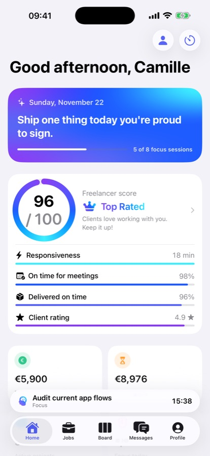
  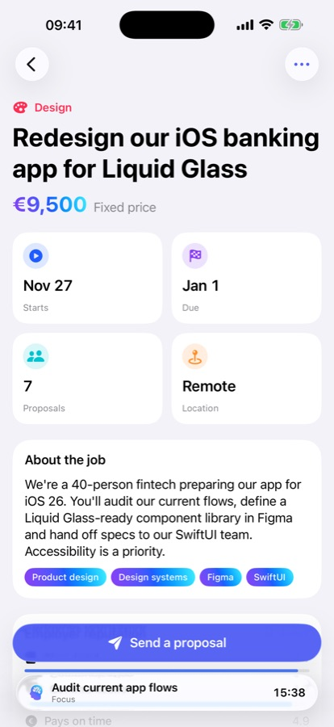
  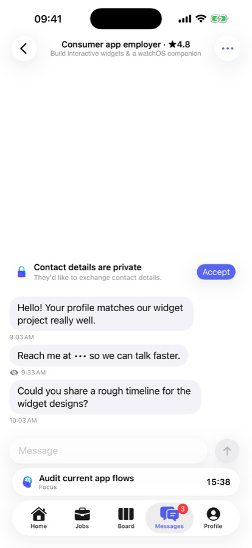
  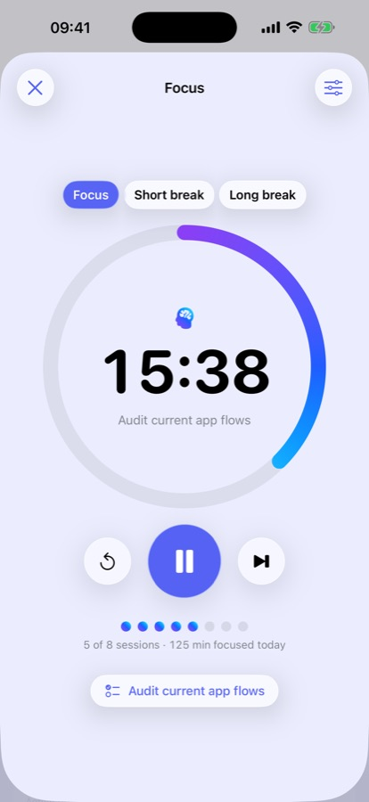
</p>

## Features

### Freelance ERP

| | |
|---|---|
| **Today** | Check in where you work (home, coworking, client site, train), log a full or half day in one tap, see when to leave for the client, what to set aside, and a gentle note when the week gets too long. |
| **Missions** | Long and short missions, daily rate, hourly or fixed price, with effective daily rate. Pipeline of leads (lead → in talks → quote sent → won). Calm warning weeks before a long mission ends. |
| **Time & activity reports** | Week strip: tap for full day, half day or off; touch and hold for on site. Monthly activity report (CRA) signed by the client with PencilKit, then locked and invoiced in one tap. |
| **Travel mode** | Apple Maps commute (car, transit, train, bike, walk), leave-by time, mileage on the official French scale (barème kilométrique, CV, electric +20 %), travel fees billed flat, at cost, or included. |
| **Quotes & invoices** | Legal French invoices: gapless yearly numbering (`FAC-2026-0042`) assigned at issue, SIRET, art. 293 B, late penalties and €40 indemnity. Issued invoices can't be deleted, only cancelled by a credit note. Reminders drafted on device. |
| **Money** | Amount to set aside this quarter, micro-entreprise and VAT thresholds with 80 %/95 % alerts, 6-month cash-flow forecast, daily rate calculator from the net income you want. |
| **Expenses** | VisionKit receipt scanning and on-device Vision OCR (amount, VAT, date, category); rebillable expenses flow into the mission's next invoice. |
| **Clients & sharing** | Import clients from Contacts, call, Message, WhatsApp or Mail with a prefilled progress update. Share work anywhere with the share sheet. |
| **My card** | vCard QR code (scan with any camera to add the contact), vCard sharing by AirDrop, Messages or WhatsApp, and an Apple Wallet pass signed by the backend. |
| **Journal** | What you did, the energy it took and who it helped: a streak, a 30-day energy trend, and any entry turned into a LinkedIn post of 500 characters max, drafted on device with Apple Intelligence. |
| **Find missions** | Searches public job APIs (Remotive, Jobicy, Himalayas), and Google Programmable Search or Brave Search with your own key (stored in the Keychain) across Malt, Free-Work and LinkedIn. Each listing is parsed into rate (with daily equivalent vs. your target), contract type, location, skills match and a readable description; save it as a lead in one tap. Apply always opens the original listing, credited to its source. |
| **Siri & Shortcuts** | "Log a day in Jobetics", "Add an expense", "How much am I owed?", "Start focus". |
| **Your tab bar** | Pick and order up to five tabs on iPhone (Calendar, Journal, Invoices…); customizable sidebar on iPad. |

### Marketplace

| | |
|---|---|
| **Dashboard & score** | A motivating home with a daily line and a freelancer score (responsiveness, punctuality, on-time delivery, client rating, profile completeness) computed server-side from verified activity. |
| **Jobs** | Anyone can post; only registered freelancers can browse and apply. **Every job must be paid**, enforced by validation, Firestore rules and AI moderation. |
| **Anonymity by default** | Freelancers and employers see skills and reputation only: no names, e-mails, phones or photos until **both** accept a contact exchange. E-mails are blocked by rules, phone numbers redacted by Functions. |
| **Employer reviews** | Freelancers rate employers on brief clarity, communication and payment, and can flag spam. |
| **Chat & push** | Real-time messages, push notifications for new messages and matching jobs (FCM), report and block. |
| **AI moderation** | Gemini via Firebase AI Logic (App Check protected) on device, and again server-side in Cloud Functions: spam, scams, unpaid work, off-platform payments, harassment, phishing, discrimination. |
| **Safe links** | Every link goes through `LinkGuard` (HTTPS, look-alike domains, punycode, shorteners, raw IPs, embedded credentials…) and opens in-app in `SFSafariViewController`; Safe Browsing server-side. |
| **Business suite** | Kanban board per project, calendar, quotes → invoices (PDF, send), accounting with charts, payouts and tax set-aside, portfolio with images & files. Stored with SwiftData and synced via the user's iCloud. |
| **Pomodoro** | Focus timer linked to board tasks, Live Activity + Dynamic Island, tab bar accessory, widget, Control Center control, Siri, and Apple Watch with haptics. |
| **Widgets** | Matched jobs, focus timer, daily motivation (Home & Lock Screen). |
| **Admin** | Moderation queue (reports + jobs held by AI), actions applied by Cloud Functions; admin via Firebase custom claim. |
| **Languages** | English, French, Spanish. |

On **iPhone** the default tabs follow the day: Today, Missions, Money, Jobs, Messages, and Profile is the avatar on Today. Every tab is the user's choice.
On **iPad** the sidebar exposes the full suite: an Apple Calendar-style month view, Board, Clients, Journal, Invoices, Quotes, Expenses, Accounting, Payouts, My card, Portfolio, Search and Moderation.

## Screenshots

### iPhone: simple and focused

<table>
  <tr>
    <td align="center"><br><sub>Motivating home & score</sub></td>
    <td align="center">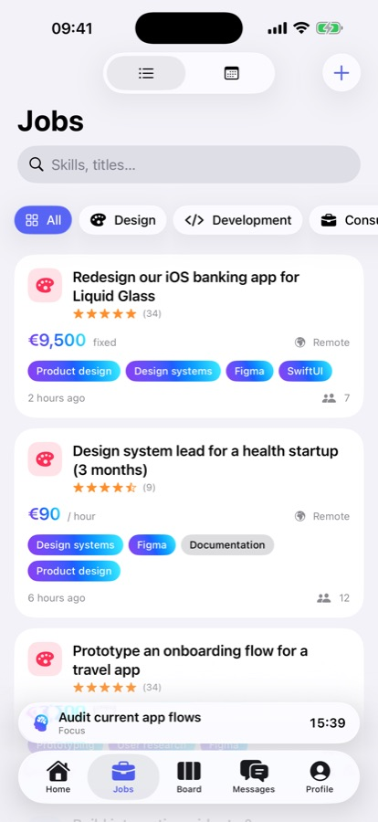<br><sub>Paid jobs matched to you</sub></td>
    <td align="center"><br><sub>Job & employer reputation</sub></td>
    <td align="center">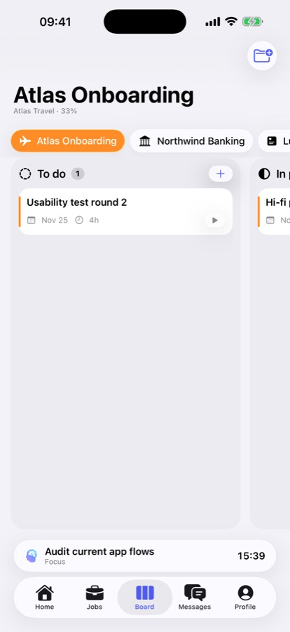<br><sub>Kanban board per project</sub></td>
  </tr>
  <tr>
    <td align="center"><br><sub>Chat, contact locked until both accept</sub></td>
    <td align="center"><br><sub>Pomodoro focus timer</sub></td>
    <td align="center">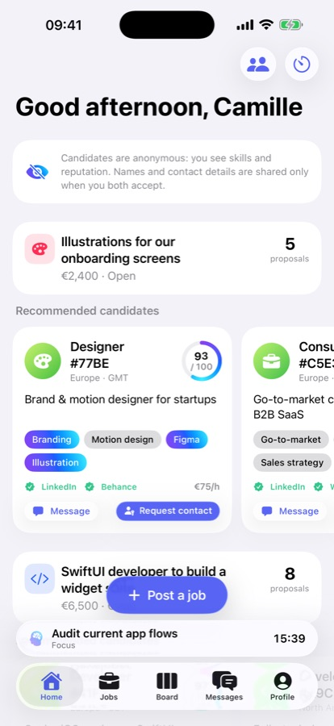<br><sub>Hiring: anonymous candidates</sub></td>
    <td align="center">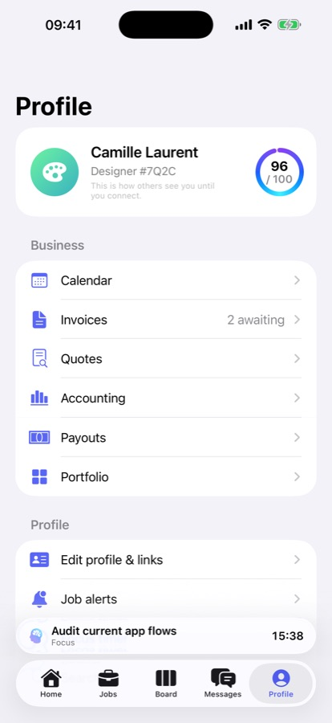<br><sub>Profile & business tools</sub></td>
  </tr>
</table>

<table align="center">
  <tr>
    <td align="center">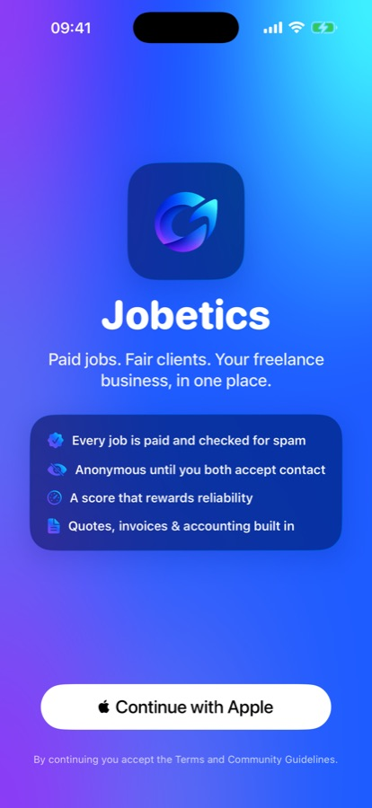<br><sub>Sign in</sub></td>
    <td align="center">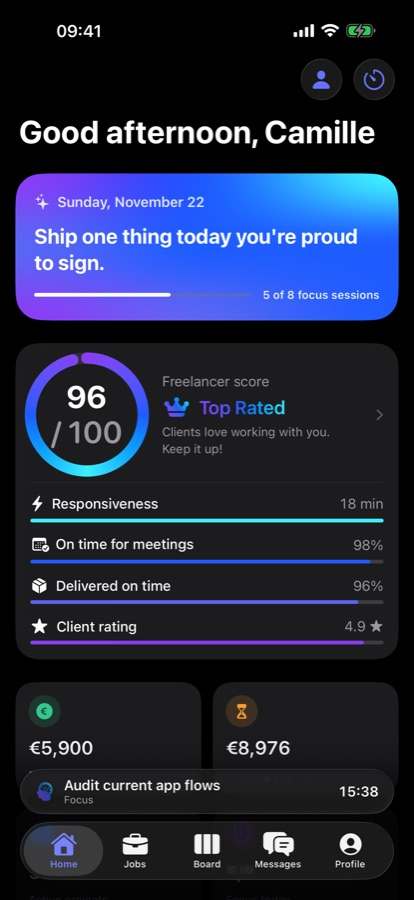<br><sub>Dark mode</sub></td>
  </tr>
</table>

### iPad: the complete business suite

<table>
  <tr>
    <td align="center">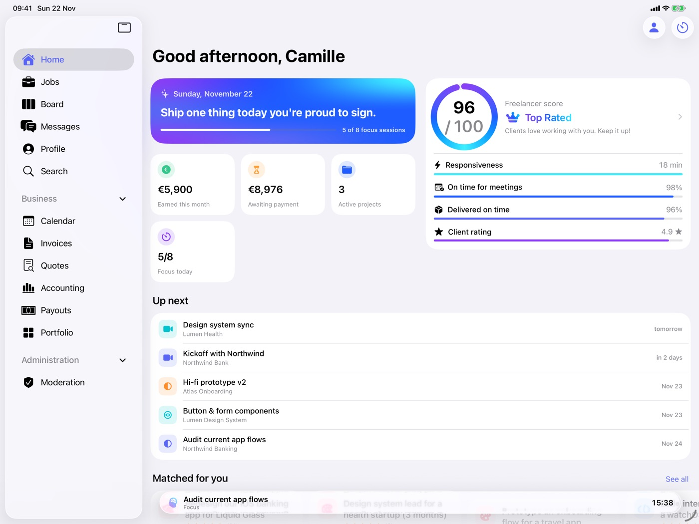<br><sub>Dashboard</sub></td>
    <td align="center">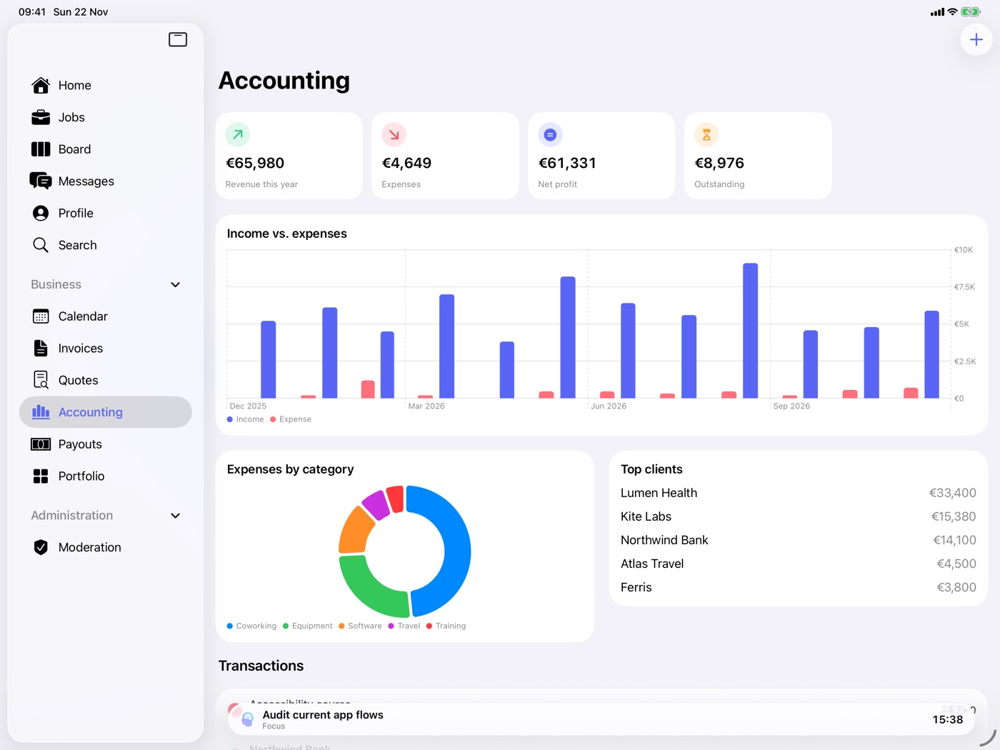<br><sub>Accounting</sub></td>
  </tr>
  <tr>
    <td align="center">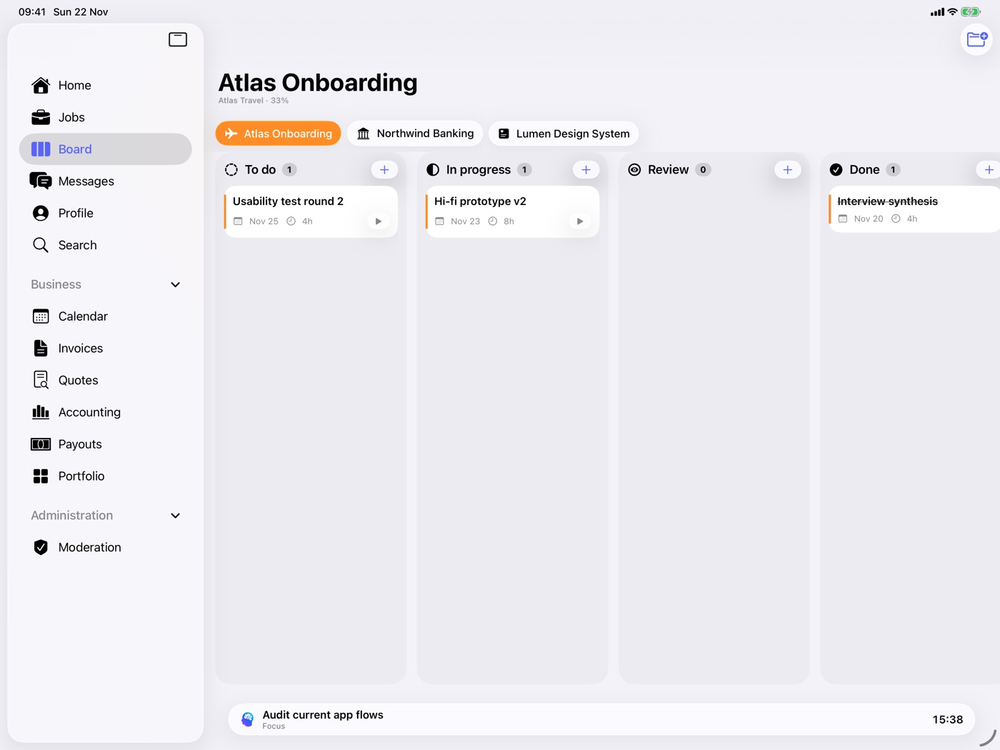<br><sub>Kanban board</sub></td>
    <td align="center">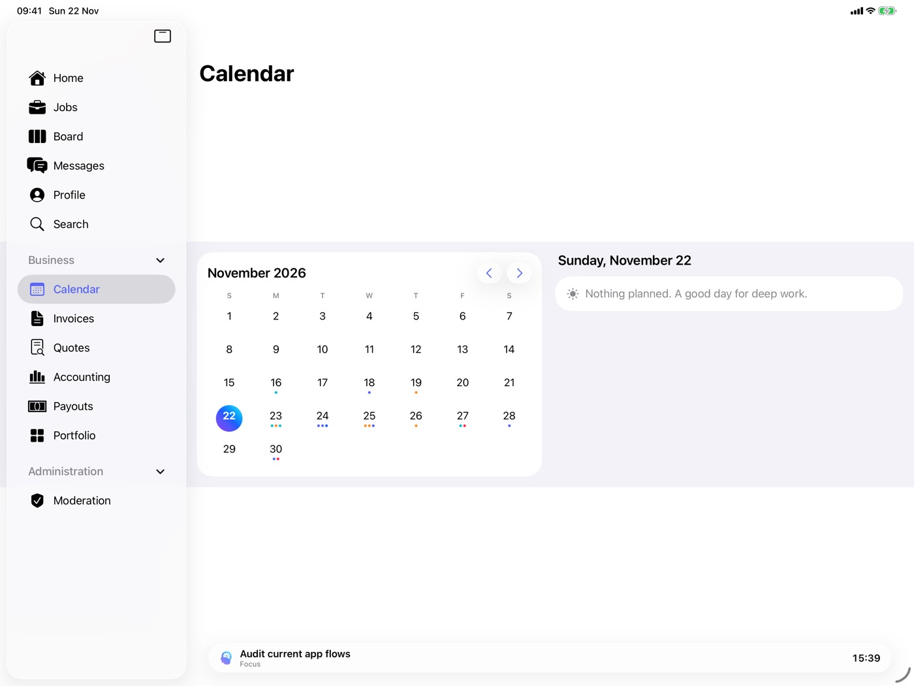<br><sub>Calendar of jobs & meetings</sub></td>
  </tr>
  <tr>
    <td align="center">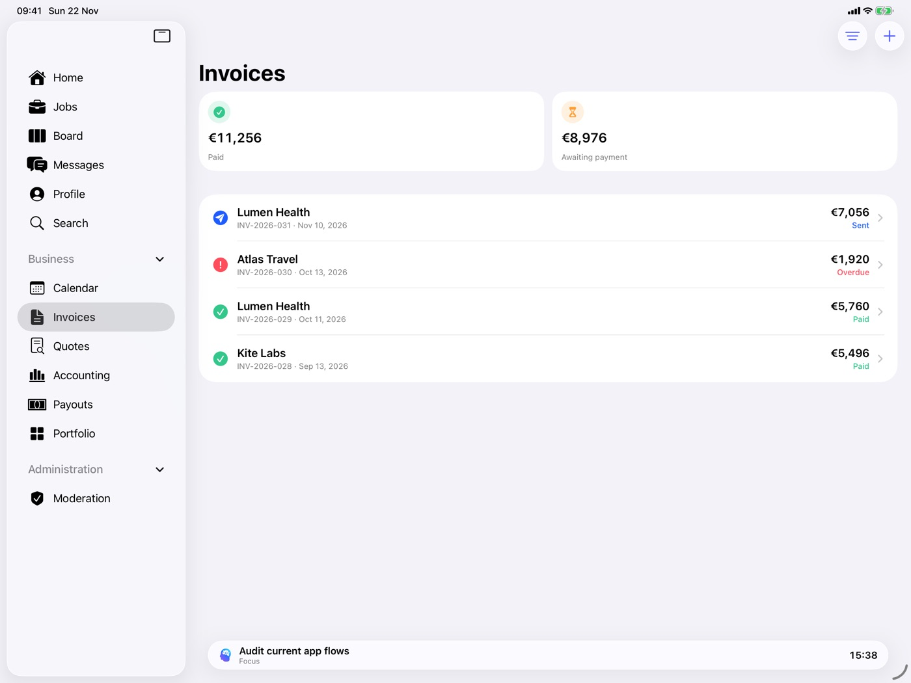<br><sub>Invoices</sub></td>
    <td align="center">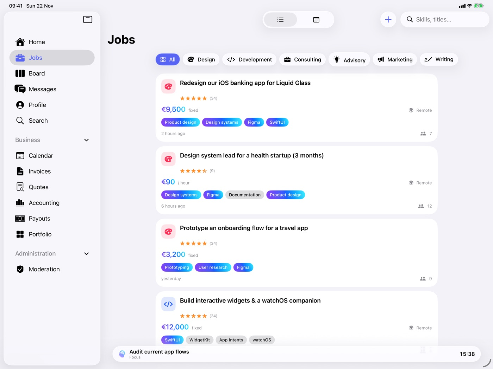<br><sub>Jobs</sub></td>
  </tr>
  <tr>
    <td align="center">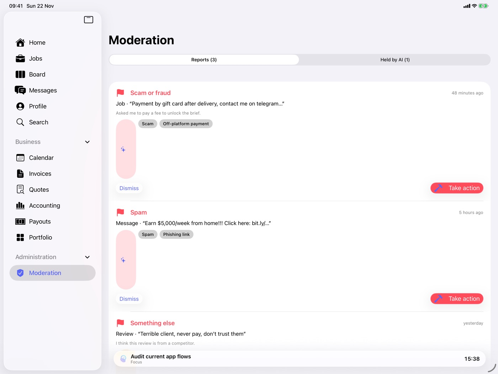<br><sub>Admin moderation queue (AI triage)</sub></td>
    <td align="center">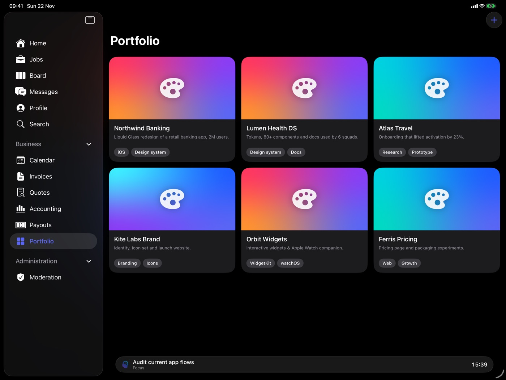<br><sub>Portfolio synced with iCloud (dark)</sub></td>
  </tr>
</table>

### Français · Español

<p align="center">
  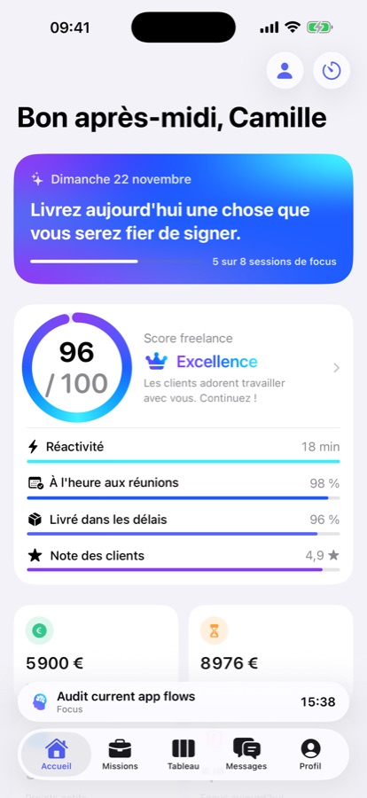
  
  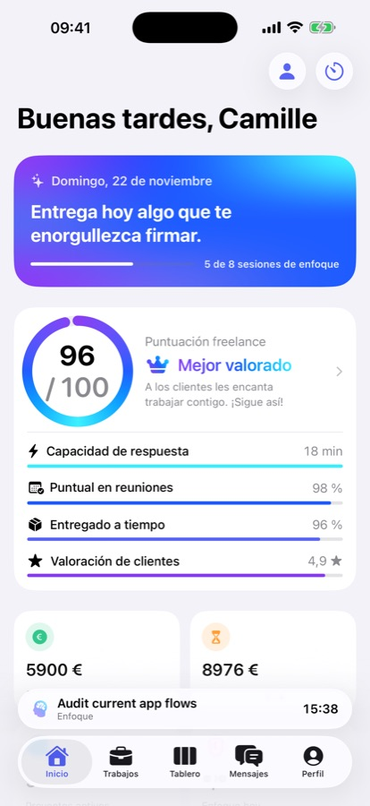
  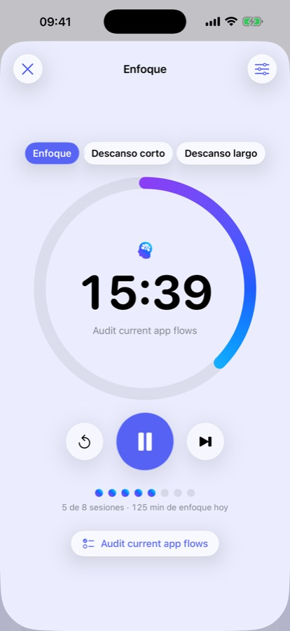
</p>
<p align="center">
  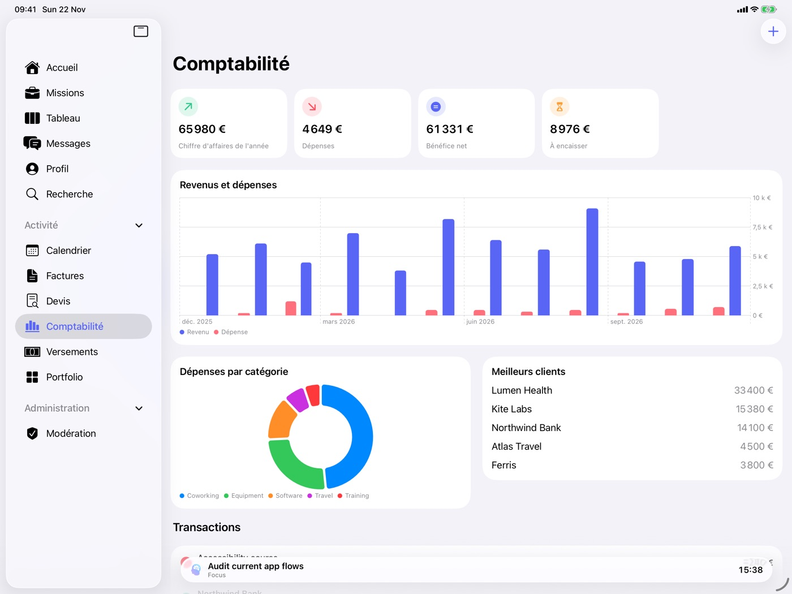
  
</p>

Screenshots are generated from the demo data with `scripts/screenshots.sh` (full-resolution App Store sizes: iPhone 6.9" and iPad 13", in `Screenshots/`, git-ignored), then `scripts/readme-previews.sh` makes the lightweight previews above.

## Getting started

```bash
git clone https://github.com/kevinvavelin/Jobetics.git
open Jobetics.xcodeproj
```

**Demo mode:** without a Firebase config the app runs on realistic sample data, with no account needed. Force it with the `-demo` launch argument.

**Your own Firebase project:**
1. Firebase console → add an iOS app with bundle id `fr.vavelinkevin.Jobetics` (or your own).
2. Enable **Authentication › Email/Password** and **Google**, **Firestore**, **Cloud Messaging** (upload an APNs key) and **AI Logic** (Gemini Developer API), which enforces **App Check**.
3. Download `GoogleService-Info.plist` **after** enabling Google sign-in (it must contain `CLIENT_ID`) to `Jobetics/GoogleService-Info.plist` (git-ignored; see `Config/GoogleService-Info.example.plist`). Google sign-in reads the client ID from it at runtime, so no URL scheme is committed.
4. Run once, copy the **App Check debug token** from the Xcode console, register it in *App Check › Apps › Manage debug tokens*. Never commit it.
5. Deploy your own Firestore security rules, indexes and Cloud Functions with the Firebase CLI. The production backend is not part of this repository.

Requirements: Xcode 26.2+, iOS/iPadOS 26.0+, watchOS 26.0+ (install the watchOS simulator runtime: `xcodebuild -downloadPlatform watchOS`).

## Security & privacy

This repository is public. Nothing in it grants access to the Firebase project:
- `GoogleService-Info.plist`, the Firebase backend folder, service accounts, App Check tokens and signing files are git-ignored.
- The Firebase API key in that plist is only an identifier. Access control lives in Firestore security rules, App Check and Cloud Functions, never in the open-source client.
- Server-side Gemini uses Vertex AI with the function's service account (no API key). The Safe Browsing key is a Secret Manager secret.
- Private business data (invoices, accounting, portfolio) never leaves the user's iCloud.

## Architecture

```
Jobetics/            iOS & iPadOS app
  App/               entry point, environment (Firebase or demo), router, adaptive TabView
  Domain/            pure, unit-tested rules: daily rate, mileage & travel fees, numbering, taxes &
                     thresholds, activity reports, cash flow, sharing (vCard, LinkedIn, WhatsApp)
  Intents/           App Intents & App Shortcuts (Siri, Shortcuts, Spotlight)
  Models/            Marketplace (Codable, Firestore) · Business & Freelance (SwiftData + CloudKit)
                     · BusinessSettings (iCloud key-value store)
  Services/          Backend (protocol, Firestore, Demo, Store) · Moderation (Gemini, ContentGuard)
                     Security (LinkGuard, SafeBrowser) · Platform (Auth, Push, FocusTimer, Commute/MapKit,
                     ReceiptScanner/Vision, WritingAssistant/Foundation Models, Wallet, QR, reminders)
  Features/          Home (Today), Missions, Money, Clients, Journal, Card, Discover, Jobs, Board,
                     Messages, Profile, Business, Focus, Search, Admin, Onboarding
Shared/              Brand, score engine, Pomodoro model, App Group store, intents, String Catalog
JobeticsWidgets/     WidgetKit: jobs, focus, motivation, control, Live Activity
JobeticsWatch/       watchOS companion: Pomodoro, motivation, score
scripts/             screenshots.sh (App Store screenshots from demo data)
```

## iPhone Duo (iOS 27.1)

The UI uses standard adaptive containers (`TabView(.sidebarAdaptable)`, size classes, `containerRelativeFrame`), which Apple says adapt automatically to each display. Fold-aware APIs (`onHingeChange`, `ArrangementView`) need the iOS 27.1 SDK (Xcode 27.1) and will be adopted behind `#if compiler` checks once the project moves to it.

## Tests

```bash
xcodebuild test -project Jobetics.xcodeproj -scheme Jobetics \
  -destination "platform=iOS Simulator,name=iPhone 17 Pro" -only-testing:JobeticsTests
```

Swift Testing covers the domain rules (rates, mileage, numbering, thresholds, penalties, activity reports, cash flow, receipts, sharing, reminders, mission earnings); UI tests cover the Today, Missions and Money flows on demo data. Tax rates, thresholds and the mileage scale are data editable in Business settings: check them against urssaf.fr and impots.gouv.fr each year.

## Roadmap

- Factur-X e-invoicing (French reform, 2026–2027)
- Widgets for days billed, unpaid total and amount to set aside; commute Live Activity on on-site days
- Focus filters per workspace; geofenced check-in at client sites
- Payments & escrow (Stripe Connect) so every job is paid through the platform
- Calendar sync (EventKit) and meeting check-ins feeding the punctuality score
- Remote Config for the Gemini model name and moderation thresholds
- Rules unit tests with the Firebase Emulator Suite

## License

**Source-available, not open source.** © 2026 Kevin Vavelin. All rights reserved.

The code is public so you can read it and learn from it. You may **not** copy, modify, redistribute, build, publish or reuse any part of it, or use the Jobetics name or branding, without prior **written approval** from Kevin Vavelin. See [LICENSE](LICENSE) for the full terms.
